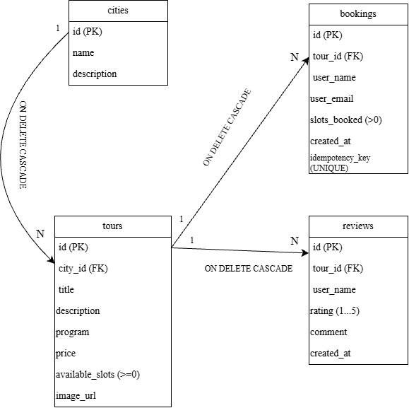

# Специфікація проєкту

## 1. Архітектура

Ланцюжок взаємодії:
`Браузер` ➔ `Routes` ➔ `Controllers` ➔ `SQLite` ➔ `EJS Шаблони` ➔ `Браузер`.

-**routes** знають лише про HTTP(розбір запиту, статус, redirect)
\-**services** — бізнес-правила: валідація, права доступу, рішення про 404/409;
\-**repositories** — увесь SQL і транзакції (`sql```-шаблони, лише параметри);
-**контекст запиту** (`AsyncLocalStorage`): сховище, користувач, business-process ID; логер додає ID до кожного рядка;
\-**один глобальний обробник помилок** (400/403/404/409/500); сервіси й репозиторії просто кидають помилки.

## 2.Cхема БД



- cities(id, name, description)
- tours(id, city_id, title, description, program, price, available_slots ≥ 0, image_url)
- bookings(id, tour_id, user_name, user_email, slots_booked > 0, created_at, idempotency_key UNIQUE)
- reviews(id, tour_id, user_name, rating 1..5, comment, created_at)
  created_at — ISO YYYY-MM-DD HH:MM:SS (UTC). Каскадне видалення, PRAGMA foreign_keys = ON.

## 3.Прототип і HTTP-інтерфейс

Спершу сценарії працюють на статичних даних, а потім на SQLite.

| Сценарій                      | Запит                        | Результат                                          |
| ----------------------------- | ---------------------------- | -------------------------------------------------- |
| 1.1.Пошук за містом           | GET /?city_id=               | 200, список турів                                  |
| 1.2.Деталі туру               | GET /tours/:id               | 200 / 404                                          |
| 1.3.Бронювання                | POST /tours/:id/book         | 303 на сторінку туру (JSON: 201) / 400 / 404 / 409 |
| 1.4.Відгук                    | POST /tours/:id/reviews      | 303 / 400 / 404                                    |
| 2.1.Новий тур                 | POST /admin/tours            | 303 / 400 / 403                                    |
| 2.2.Зміна туру                | POST /admin/tours/:id/update | 303 / 400 / 403 / 404                              |
| 2.3, 2.4.Відгуки і бронювання | GET /admin                   | 200 / 403                                          |

## 4.Сценарії та SQL

Сценарії користувача.
**1.1**вибір міста та пошук екскурсій. Якщо місто не обране, повертаються всі тури.
SELECT t.*, c.name AS city_name FROM tours t LEFT JOIN cities c ON c.id = t.city_id WHERE (? IS NULL OR t.city_id = ?) ORDER BY t.id;

**1.2**перегляд опису екскурсій. Інформація про екскурсію разом з містом:
SELECT t.*, c.name AS city_name FROM tours t LEFT JOIN cities c ON c.id = t.city_id WHERE t.id = ?;
Відгуки цієї екскурсії:
SELECT * FROM reviews WHERE tour_id = ? ORDER BY datetime(created_at) DESC, id DESC;

**1.3**бронювання місць.
SELECT * FROM bookings WHERE idempotency_key = ?;

UPDATE tours
SET available_slots = available_slots - ?
WHERE id = ? AND available_slots >= ?;

INSERT INTO bookings
(tour_id, user_name, user_email, slots_booked, created_at,idempotency_key)
VALUES (?, ?, ?, ?, ?, ?);

**1.4**залишення відгуку.
INSERT INTO reviews (tour_id, user_name, rating, comment, created_at) VALUES (?, ?, ?, ?, ?);

Сценарії адміністратора.

**2.1**додавання нової екскурсії.
INSERT INTO tours (city_id, title, description, program, price, available_slots, image_url) VALUES (?, ?, ?, ?, ?, ?, ?);

**2.2** зміна екскурісії.
UPDATE tours SET title = COALESCE(?, title), description = COALESCE(?, description), program = COALESCE(?, program), price = COALESCE(?, price), available_slots = COALESCE(?, available_slots), image_url = COALESCE(?, image_url) WHERE id = ?;

**2.3** аналіз відгуків.
SELECT r.*, t.title AS tour_title FROM reviews r LEFT JOIN tours t ON t.id = r.tour_id ORDER BY datetime(r.created_at) DESC, r.id DESC;

**2.4**перевірка бронювань
SELECT b.*, t.title AS tour_title FROM bookings b LEFT JOIN tours t ON t.id = b.tour_id ORDER BY datetime(b.created_at) DESC, b.id DESC;

## 5.Сценарії помилок

|№ |Ситуація |Очікувана поведінка |
| -------------------------------- | --------------------------------------------------------------------------- |
| 1. | Місць менше, ніж просять |404, бд не змінюється |
| 2. | Порожні обов'язкові поля | 400, дані не записуються |
| 3. | Некоректні дані | 400 з поясненнями |
| 4. | Неіснуючий тур/маршрут | 404 |
| 5. | Не адмін | 403 |
| 6. | Збій або недоступність Бд | 500 |
| 7. |Паралельні бронювання | транзакції йдуть по черзі; зайві запити отримують 409, сервер не зупиняється|
| 8. |Повторне надсилання форми |redirect після POST + idempotency_key: друге бронювання не створюється |
| 9. |Тимчасовий SQLite_Busy |до 3 повторів транзакції з паузою; нетимчасові помилки не повторюються |
