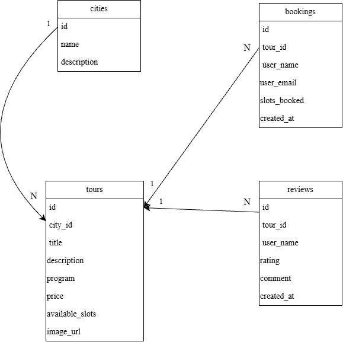

Специфікація проєкту

1. Архітектура та компоненти (Модулі Node.js)

- Логіка сервера розділена на чотири основні частини:
- Маршрутизація (`Routes`): Приймає HTTP-запити від користувача (`GET`, `POST`) та спрямовує їх до відповідного модуля.
- Контролери (`Controllers / Services`): Містять бізнес-логіку: обробку та перевірку даних перед збереженням чи виведенням.
- База даних (`Database / Models`): Відповідає за з'єднання з PostgreSQL та виконання SQL-запитів.
- Подання (`Views / EJS`): Генерує готові HTML-сторінки за допомогою шаблонізатора EJS, Bootstrap 5 та інтерактивних карт Leaflet.js.

Ланцюжок взаємодії:
`Браузер` ➔ `Routes` ➔ `Controllers` ➔ `PostgreSQL` ➔ `EJS Шаблони` ➔ `Браузер`.

2.  Структура бази даних та зв'язки (ER-модель)
    У файловій базі даних SQLite проєктуються такі основні таблиці:
    1.users (Користувачі та ролі): Зберігає інформацію про всіх учасників системи (id, name, email, password_hash, role).
    2.tours (Тури / Маршрути): Зберігає загальну інформацію про маршрути та їхніх творців (id, guide_id, title, description, price, image_url, map_coordinates).
    3.reviews (Відгуки): Зберігає відгуки користувачів (id, tour_id, user_id, rating, comment, created_at).

Зв'язки:
Один гід має багато турів(`One-to-Many` через поле `guide_id` у таблиці `tours`).
Один тур має багато відгуків (`One-to-Many` через поле `tour_id` у таблиці `reviews`).
Один користувач залишає багато відгуків (`One-to-Many` через поле `user_id` у таблиці `reviews`).

3.  Ключові сценарії роботи
    Сценарії для користувача:
    Сценарій 1.1: Вибір міста та пошук екскурсій
    Кроки:
    Користувач переходить на головну сторінку або сторінку вибору міст та обирає конкретне місто зі списку чи через пошук.
    Сервер обробляє запит і здійснює пошук доступних екскурсій для цього міста.
    Сервер формує готову HTML-сторінку зі списком знайдених турів та відправляє її у браузер.
    Очікуваний результат: Користувач бачить візуально привабливий список екскурсій, які проводяться саме у вибраному місті, з їхніми назвами, фотографіями та цінами.

Сценарій 1.2: Перегляд детального опису екскурсії
Кроки:
Користувач клікає на картку конкретної екскурсії зі списку для перегляду детальної інформації.
Сервер збирає повну інформацію про обраний тур (опис, програму, ціну, доступні місця), а також підтягує пов'язані з ним відгуки.
Сервер рендерить детальну сторінку туру та відображає її у браузері.
Очікуваний результат: Користувач отримує повний огляд екскурсії: розгорнутий опис, програму поїздки, вартість, кількість вільних місць та список реальних відгуків інших туристів.

Сценарій 1.3: Бронювання місць на екскурсію
Кроки:
Користувач на сторінці детального перегляду екскурсії заповнює форму бронювання (вказує своє ім'я, email та кількість місць) і натискає кнопку «Забронювати».
Сервер приймає та перевіряє введені дані й наявність достатньої кількості вільних місць.
Система фіксує бронювання та зменшує лічильник доступних місць на екскурсії, після чого перенаправляє користувача назад на сторінку туру з повідомленням про успіх.
Очікуваний результат: Місця успішно заброньовані, кількість вільних місць на екскурсії автоматично зменшилась, а користувач бачить підтвердження про успішне оформлення поїздки.

Сценарій 1.4: Залишення відгуку про поїздку
Кроки:
Користувач на сторінці конкретного туру заповнює форму відгуку (оцінка від 1 до 5 та текст коментаря) і натискає «Надіслати».
Сервер приймає та перевіряє коректність оцінки й коментаря, а потім зберігає відгук у системі.
Сервер робить перенаправлення користувача назад на сторінку цього ж туру.
Очікуваний результат: Сторінка оновлюється, і новий відгук користувача з'являється у загальному списку відгуків на сторінці екскурсії.

Сценарії для адміністратора:
Сценарій 2.1: Додавання нових екскурсій
Кроки:
Адмін заповнює форму створення туру (назва, опис, програма, ціна, доступні місця, місто тощо) у панелі керування та надсилає дані.
Сервер зчитує та перевіряє передані дані, після чого створює новий запис про екскурсію в системі.
Сервер робить перенаправлення адміна на оновлену сторінку зі списком усіх турів.
Очікуваний результат: Нова екскурсія успішно додана до системи і одразу з'являється у загальному каталозі платформи для пошуку користувачами.

Сценарій 2.2: Керування розкладом
Кроки:
Адмін обирає екскурсію для редагування, змінює параметри розкладу чи доступних місць у спеціальній формі та надсилає запит на оновлення.
Сервер зчитує оновлені дані та перезаписує відповідну інформацію в системі.
Після успішного оновлення сервер перенаправляє адміна на сторінку управління екскурсіями.
Очікуваний результат: Розклад або параметри екскурсії успішно оновлені в системі, і користувачі бачать актуальну інформацію на сайті.

Сценарій 2.3: Аналіз відгуків
Кроки:
Адмін переходить у розділ аналізу відгуків або відкриває сторінку конкретної екскурсії для перевірки зворотного зв'язку.
Сервер збирає всі відгуки, залишені користувачами для цього туру.
Сервер формує і виводить в адміністративну панель зведений список відгуків.
Очікуваний результат: Адміністратор бачить повну картину оцінок та коментарів від туристів, що дозволяє оцінити якість проведення екскурсії.

Сценарій 2.4: Перевірка статусу бронювань
Кроки:
Адмін відкриває розділ перегляду всіх бронювань або бронювань конкретного туру в адмін-панелі.
Сервер формує актуальний перелік усіх оформлених бронювань із прив'язкою до екскурсій.
Система виводить список туристів, їхні контакти та кількість зайнятих місць.
Очікуваний результат: Адміністратор має повну інформацію про те, хто і скільки місць забронював на ту чи іншу екскурсію, що допомагає в організації поїздок.

Cхема БД

